# Build a Small LLM from Scratch

> **Assignment report and project guide.** This is the single Markdown document for
> the project: technical report, setup guide, reproducibility instructions, evidence
> index, links, and demonstration checklist.

## Project links

- **Live Render API:** [https://minigpt-api.onrender.com](https://minigpt-api.onrender.com)
  - Interactive API documentation: [https://minigpt-api.onrender.com/docs](https://minigpt-api.onrender.com/docs)
- **Google Colab:** [Open the Colab walkthrough](https://colab.research.google.com/drive/1bF2CPcHV34PHYP4P9T-CPHkvKpG9zYR_#scrollTo=I0n1_nZb0hi6)
- **Medium article:** [Build a Small LLM from Scratch](https://medium.com/@shuzaifaali05/build-a-small-llm-from-scratch-73897648ada1?postPublishedType=initial)
- **Checkpoint release:** [minigpt_final.pt](https://github.com/HarisAhmed1234/AI_Engineering/releases/download/v1.0/minigpt_final.pt)
- **Video Demo:** https://github.com/HarisAhmed1234/AI_Engineering/releases/tag/demo-v1.0

## Repository map

| Location | Purpose |
| --- | --- |
| `src/` | Tokenizer, dataset, attention, positional encoding, Transformer blocks, GPT model, training, generation, and utilities. |
| `tests/` | Tests for attention, masks, shapes, shifted targets, overfitting, and API routes. |
| `configs/tiny_gpt.yaml` | Reproducible model and training configuration. |
| `experiments/` | Scripts that produce the report evidence and ablation results. |
| `outputs/figures/` | Required figures used throughout this report. |
| `outputs/logs/` and `outputs/samples/` | Measured logs and fixed-prompt generated samples. |
| `checkpoints/minigpt_final.pt` | Compact best-validation checkpoint used for inference. |
| `app/` | FastAPI application used locally and on Render. |
| `notebooks/colab_demo.ipynb` | Google Colab walkthrough. |

## Setup and reproducibility

Use Python 3.12. Create an environment and install the dependencies:

```powershell
py -3.12 -m venv .venv
.\.venv\Scripts\Activate.ps1
python -m pip install --upgrade pip
python -m pip install -r requirements.txt
python -m pip install -r requirements-dev.txt
```

Download the Tiny Shakespeare corpus, then run the test suite:

```powershell
python data/download_tiny_shakespeare.py
python -m pytest
```

Train the model with the recorded configuration:

```powershell
python -m src.train --config configs/tiny_gpt.yaml
```

Generate from the selected checkpoint:

```powershell
python -m src.generate --prompt "ROMEO:" --max-new-tokens 80 --temperature 0.8 --top-k 40 --seed 7 --checkpoint checkpoints/minigpt_final.pt
```

Run the API locally when needed:

```powershell
python -m uvicorn app.main:app --host 127.0.0.1 --port 8000
```

Open `http://127.0.0.1:8000/docs` for interactive local API documentation. The
deployed version is available through the Render link above.

## Demonstration checklist (5–7 minutes)

1. Show the repository tree and identify `src/`, `tests/`, `configs/`,
   `experiments/`, `outputs/`, and `app/`.
2. Open `src/gpt.py` and explain token embedding, positional encoding,
   Transformer blocks, final LayerNorm, and the language-model head.
3. Open `src/attention.py`; explain Q, K, V, scaled dot-product attention, and
   the causal mask. Show Figures 1 and 2.
4. Show `outputs/figures/fig_m3_mlm_vs_clm.png` and explain why bidirectional MLM
   differs from causal GPT generation.
5. Run `python -m pytest`; then show the multi-head shape trace and positional
   encoding in Figures 3 and 4.
6. Open `configs/tiny_gpt.yaml` and Figure 5; state the 128-character context,
   width 128, four heads, four blocks, FFN width 512, and 809,984 parameters.
7. Show the loss curve in Figure 6, then run the generation command above.
8. Show Figures 7, 8, and 9: trained attention, five fixed-prompt samples, and
   the three controlled ablation studies.
9. Open `app/main.py`, then the live Render `/docs` page. Send one request to
   `POST /generate` and show the generated response.
10. End with the main limitation: the model learns local Shakespeare-like style but
    can be incoherent and has only 128 characters of usable context.

## 1. Problem and scenario

This assignment builds a small, understandable GPT-style causal language model from
a raw text corpus rather than adapting a pretrained model. The system turns Tiny
Shakespeare characters into deterministic token IDs, predicts the next character
from a left-to-right prefix, and generates one character at a time. The learning
goal is inspection: hand calculations, tests, figures, and controlled experiments
make the Transformer mechanisms visible rather than treating the model as a black
box.

The resulting model is deliberately small and character-level. All 809,984
parameters were learned from Tiny Shakespeare alone; no pretrained model weights or
high-level Transformer model class was used. Its continuations can resemble
Shakespearean formatting and vocabulary, but are experimental text, not reliable
facts or general-purpose assistance. A CLI and compact FastAPI service package the
best-validation checkpoint for reproducible local inference and deployed use.

## 2. Transformer foundations (M1 evidence)

### Scaled dot-product self-attention

For queries `Q`, keys `K`, and values `V`, scaled dot-product attention is:

`scores = QK^T / sqrt(d_k)`

`weights = softmax(scores)`

`output = weights V`

With batch size `B`, sequence length `T`, and model width `D`, the input has shape
`(B, T, D)`. The projected `Q` and `K` have shape `(B, T, d_k)`; the score and
weight matrices have shape `(B, T, T)`; `V` has shape `(B, T, d_v)`; and the
weighted values have shape `(B, T, d_v)`. Figure 1 is generated by the project’s
hand-calculation script and independently verified against `src.attention`.

For causal generation, scores above the main diagonal are set to negative infinity
before softmax. Thus position 1 sees only itself, position 2 sees positions 1–2,
and position 3 sees positions 1–3. The implementation test also changes future
tokens and proves earlier causal outputs do not change. Figure 2 makes the same
constraint visible as a standalone allowed/blocked matrix.

### Why Transformers

An RNN has `O(n)` sequential operations and maximum path length `O(n)`: each state
depends on the preceding state. Self-attention computes all query-key comparisons
as matrix operations, giving `O(1)` sequential operations and maximum path length
within a layer, but uses a `T x T` attention matrix. The M1 benchmark records actual
runtime and memory allocations across sequence lengths in its CSV and plot. On the
local CPU run (batch size 8, `d_model=64`, median of 12 forward passes), RNN versus
self-attention time was: 1.774 versus 2.116 ms at T=32; 3.145 versus 1.823 ms at
T=64; 5.674 versus 2.999 ms at T=128; and 10.668 versus 5.336 ms at T=256.
CPU-profiler allocations per forward were 0.316 versus 0.439 MiB at T=32, 0.629
versus 1.133 MiB at T=64, 1.254 versus 3.281 MiB at T=128, and 2.504 versus 10.625
MiB at T=256. The CPU allocator measurement is not described as GPU peak memory.

On the confirmed CUDA environment (PyTorch 2.6.0+cu124, RTX 4050 Laptop GPU), CUDA
synchronization was performed around every timing. RNN versus self-attention timing
was 0.609 versus 1.291 ms at T=32, 0.628 versus 1.343 ms at T=64, 0.522 versus
1.350 ms at T=128, and 0.623 versus 1.207 ms at T=256. Peak CUDA allocated memory
was respectively 8.765 versus 9.659 MiB, 17.515 versus 10.221 MiB, 18.765 versus
11.721 MiB, and 21.600 versus 16.221 MiB. These small timing benchmarks are noisy
(clock state, library kernels, and other processes affect them), so they are evidence
of one measured setup rather than a universal speed conclusion.

At these tiny CUDA benchmark sizes, the RNN (using cuDNN) showed *higher* peak GPU
allocation than attention at several lengths. This is what was measured; it does not
support a claim that the CUDA result demonstrates attention's `O(T^2)` memory cost.
A likely reason is cuDNN workspace and fixed-library overhead dominating such a small
workload. Only the CPU-profiler curve here visibly shows the faster attention-memory
growth as sequence length increases. The report preserves this difference rather than
forcing the observed GPU data to match the asymptotic story.

### Multi-head attention and position information (M2 evidence)

M2 implements a configurable number of heads with the explicit transformation
`(B,T,D) -> (B,H,T,d_head)`, where `d_head = D/H`; an assertion prevents a remainder.
Each head gets its own score and causal-weight matrices, produces its own weighted
value output, and the head outputs are concatenated back to `(B,T,D)` before a final
projection. Figure 3 prints the complete trace and actual outputs for both heads.

Attention alone is permutation-equivariant and therefore does not know token order.
The sinusoidal encoding adds fixed sine/cosine vectors to embeddings before attention.
Figure 4 shows its heatmap, curves, and between-position cosine similarity. An
untrained learned-position baseline is included only as a structural comparison; no
performance interpretation is claimed before a controlled training experiment.

### Transformer block and MLM versus CLM (M3 evidence)

The decoder block uses pre-LayerNorm: `x = x + attention(LayerNorm(x))`, followed by
`x = x + FFN(LayerNorm(x))`. The FFN is `Linear(D, 4D) -> GELU -> Linear(4D, D) ->
Dropout`. Normalizing before each sublayer leaves a direct residual gradient path and
is typically more stable for deep language-model training than relying on especially
careful warmup. The block’s causal test perturbs future tokens and confirms earlier
outputs remain unchanged.

MLM and CLM differ in both available context and objective. A bidirectional MLM
encoder may use surrounding left and right context to reconstruct a deliberately
hidden token, which suits representation learning and fill-in-the-blank tasks. A
causal LM sees only the prefix and predicts the next token, which permits consistent
left-to-right generation. In the measured M3 synthetic experiment, the label at
position `t` was the input token at `t+1`. Bidirectional attention exposes that
future target: a deterministic direct copier achieved cross-entropy `0.0000`, and a
tiny trained model fell from `2.7976` to `0.0001` in 150 steps. With the causal mask,
the same tiny model went from `2.8085` to `1.6146`, because it cannot directly read
key `t+1`. This is an information-leak demonstration, not a claim about real
Shakespeare quality. The synthetic tokens are random; the causal loss reduction
reflects memorization of 64 repeated sequences, not language ability.

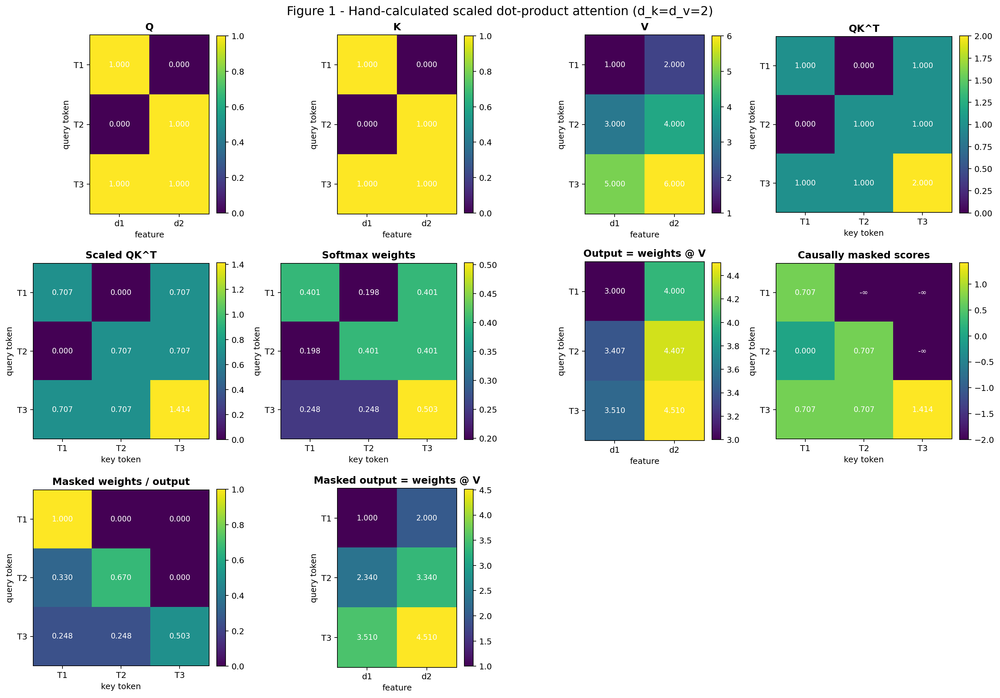

*Figure 1. Explicit Q, K, V, scaled scores, softmax weights, outputs, and the
causally masked counterparts. The generated figure is paired with terminal tables
so the source calculation is inspectable.*

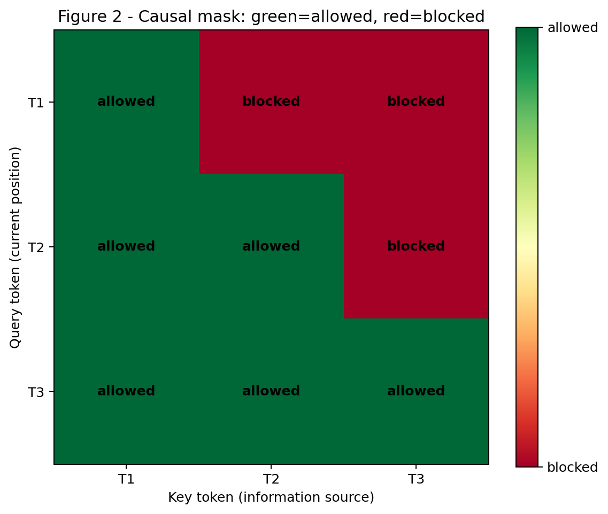

*Figure 2. The standalone causal mask. Each row is a query position and each column
is a possible information source; red future positions are blocked before softmax.*

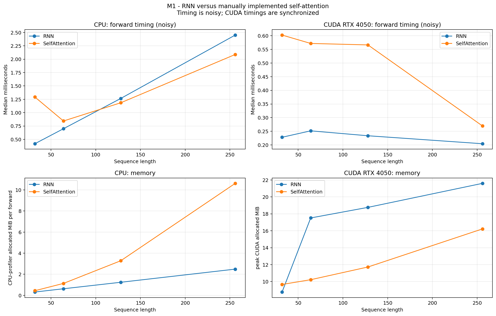

*M1 supplementary evidence. The four panels separate measured CPU timing and
CPU-profiler allocations from synchronized CUDA timing and peak CUDA allocation.
Timing is labeled noisy and is not generalized beyond this setup.*

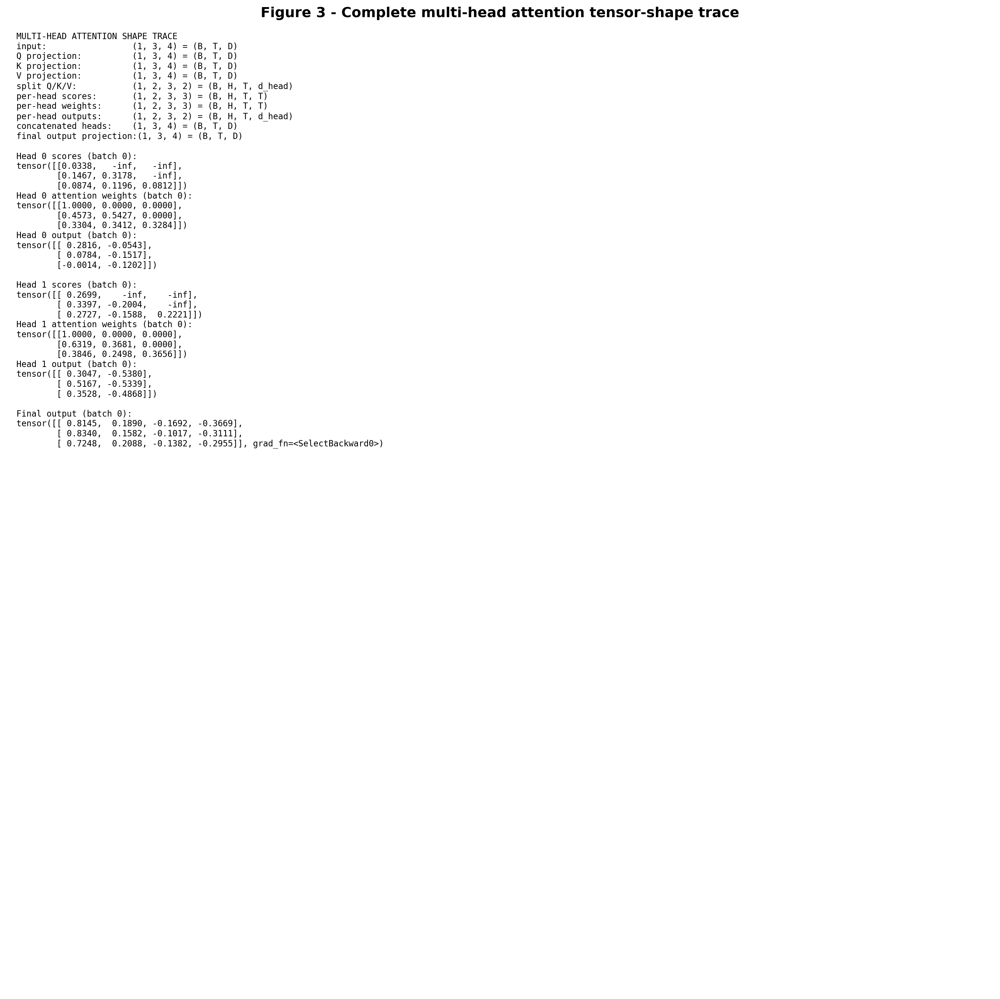

*Figure 3. Exact tensor shapes, causal score/weight matrices, per-head outputs,
concatenation, and final projection from the project’s M2 implementation.*

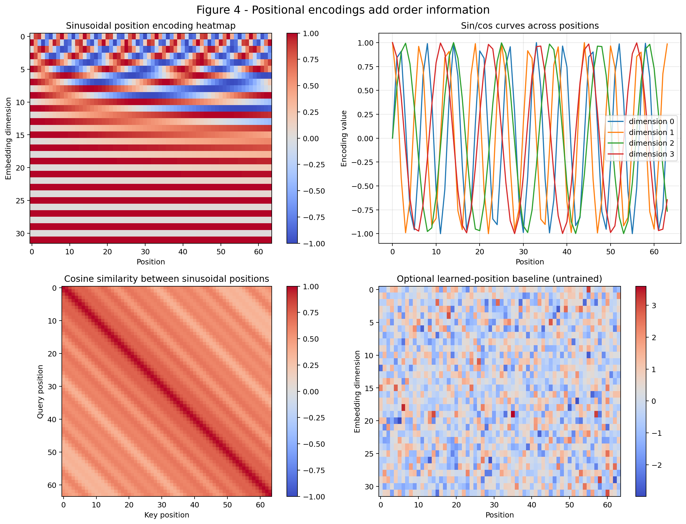

*Figure 4. Fixed sinusoidal position patterns, their similarity structure, and the
optional untrained learned-position baseline.*

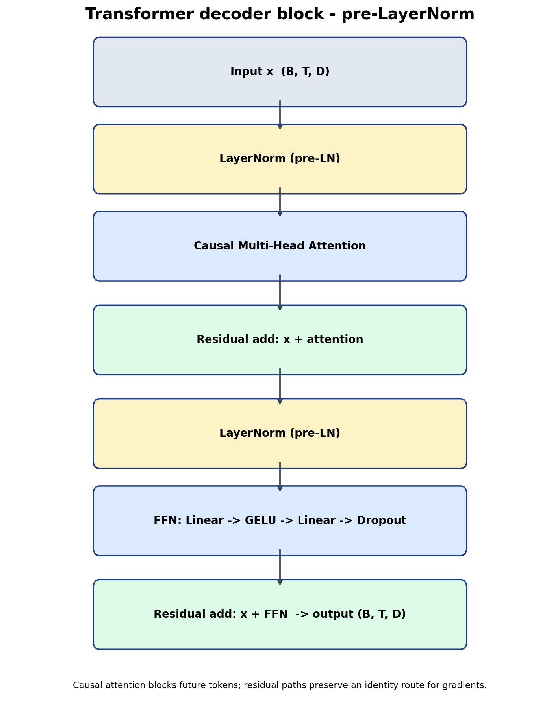

*M3 architecture evidence. A pre-LayerNorm decoder block with causal multi-head
attention, residual connections, and a GELU feed-forward network.*

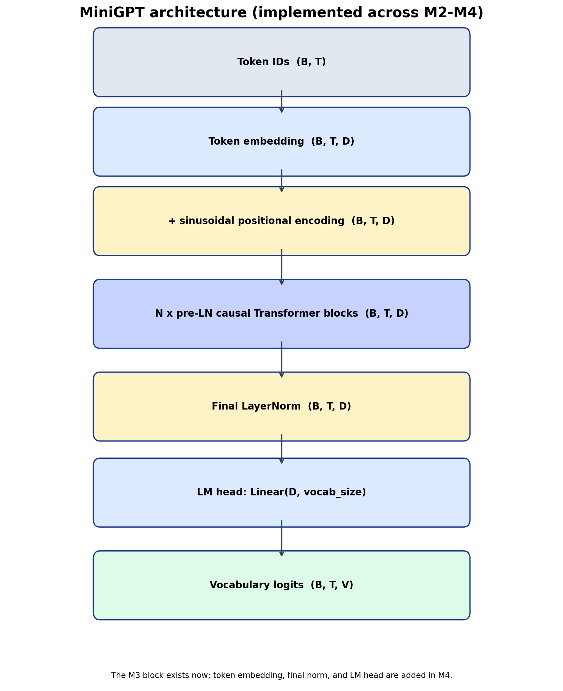

*M3 architecture evidence. The complete MiniGPT flow; embedding, final normalization,
and LM head are implemented in M4.*

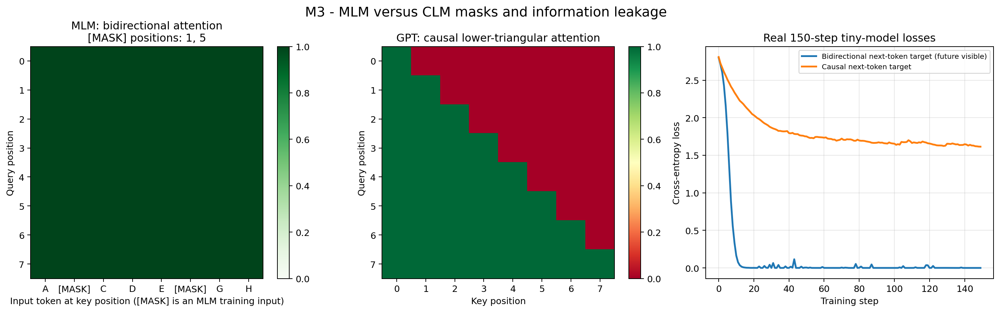

*M3 objective evidence. Bidirectional visibility exposes the next-token label at
key `t+1`; causal attention blocks that path. The plotted losses are real 150-step
runs recorded in `outputs/logs/m3_mlm_vs_clm_losses.csv`.*

## 3. Implementation (M4 pipeline evidence)

The tokenizer is deterministic character-level tokenization: it sorts the corpus’s
unique characters and assigns their indices. The downloaded Tiny Shakespeare corpus
produced 65 tokens. There are no `<pad>` or `<unk>` special tokens because every
observed character is valid and fixed-size context windows require no padding. The
vocabulary is saved in JSON and included in every checkpoint.

`MiniGPT` maps IDs `(B,T)` to token embeddings `(B,T,D)`, adds switchable sinusoidal
or learned position vectors, applies N pre-LN causal Transformer blocks, final
LayerNorm, and an LM head to produce `(B,T,V)` logits. The default model uses 128
dimensions, four heads, four blocks, 512 FFN width, and no weight tying. Embeddings
are not multiplied by `sqrt(D)`; the design uses direct GPT-style embedding scale.
Linear and embedding weights start from normal standard deviation 0.02, while
residual projections use `0.02/sqrt(2N)`.

## 4. Dataset and preprocessing (M4 evidence)

The downloader retrieved the public Karpathy Tiny Shakespeare corpus (with a Hugging
Face mirror fallback) into ignored local file `data/input.txt`: 1,155,394 bytes and
40,000 lines. No text filtering was applied. The 90/10 train/validation split occurs
once by corpus position before windowing, so no sample crosses the split boundary.
Each window has `x=tokens[i:i+128]` and `y=tokens[i+1:i+129]`.

## 5. Training setup

The M5 run used Tiny Shakespeare with the fixed 90/10 positional split, seed 1337,
64 windows per batch, 128-character context, and training stride 32; validation
windows retained stride 128. The model had 65 vocabulary entries, `d_model=128`,
four heads, four blocks, FFN width 512, dropout 0.1, sinusoidal positions, no weight
tying, and 809,984 parameters. AdamW used weight decay 0.1 only for eligible matrix
weights; LayerNorm parameters, biases, and embeddings were excluded. The schedule
was 100 linear warmup steps then cosine decay, gradient clipping was 1.0, and the run
had 40,000 optimization steps with evaluation every 500 steps.

A matched 300-step tuning check (same seed, warmup, data split, and model except for
learning rate) measured validation loss 3.242578 for `3e-4` and 2.515353 for `1e-3`.
The M5 run therefore used `1e-3`; this is a measured choice for this short check, not
a general learning-rate claim. The 200-step throughput check measured 298,478
tokens/s and informed the original run-length estimate.

The configuration was selected as a compact fit for the 6 GiB laptop GPU: a
128-character context and `d_model=128` retained the handout’s suggested starting
scale, four heads divide that width evenly, four blocks provide non-trivial depth,
and FFN width 512 is exactly `4*d_model`. The 40,000-step budget fit the intended
roughly 15–25 minute run after the throughput measurement. Inference uses the
best-validation checkpoint rather than the last checkpoint because validation loss
was lowest at step 21,000. That selection uses the same validation windows monitored
during training, so its best validation score is slightly optimistic relative to an
unseen test set.

Training ran on an NVIDIA GeForce RTX 4050 Laptop GPU (6.0 GiB) with PyTorch
2.6.0+cu124 and CUDA runtime 12.4. A finite forward/backward probe selected float16
CUDA AMP. The final log reported 335.78 MiB peak allocated GPU memory. Full and last
training checkpoints include optimizer state for resuming; the compact
`minigpt_final.pt` inference file contains only model weights, configuration, and
vocabulary, selected from the best-validation checkpoint.

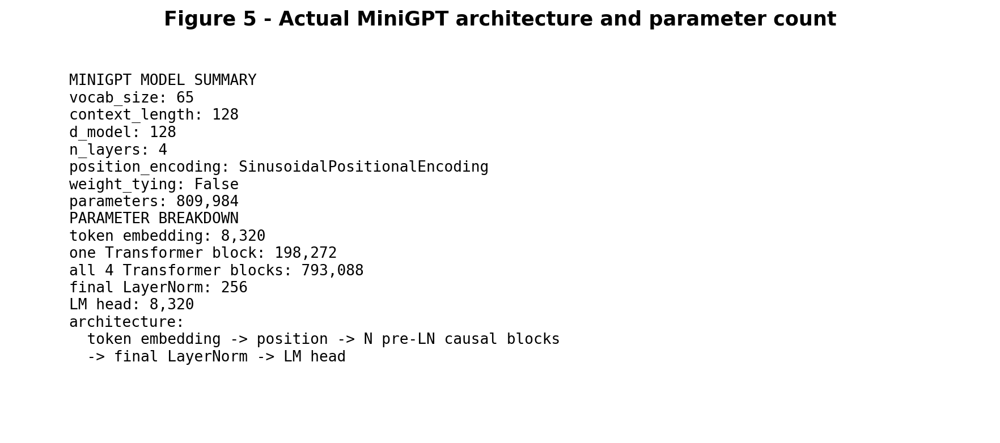

*Figure 5. Actual default MiniGPT configuration and 809,984 parameter count, produced
by the model-summary function rather than copied from a design estimate.*

## 6. Results

The full run completed all 40,000 steps in 1,516.183 seconds (25 minutes 16.183
seconds). The final logged average training loss was 1.129923, final validation loss
was 1.519580, and final validation perplexity was 4.570307. The lowest logged
validation loss was 1.491856 at step 21,000 (perplexity 4.445340). A fresh process
reloaded `checkpoints/best.pt` and evaluated all 14 available validation batches;
it measured validation loss 1.4918562940 and perplexity 4.4453397223, consistent
with the rounded training-log value.

The observed curve shows that after step 21,000, validation loss was slightly higher
while the average training loss continued to fall. At the final step this gap was
1.129923 training loss versus 1.519580 validation loss. This report records that
observed train/validation gap; `minigpt_final.pt` therefore uses the step-21,000
best-validation weights rather than the last-step weights. Its size is 3.177 MiB.

Five fixed-prompt samples used the best-validation checkpoint, temperature 0.8,
top-k 40, fixed seeds 101, 202, 303, 404, and 505, and a 200-new-character budget.
The saved evidence preserves the model's real line breaks; only an incomplete final
alphabetic fragment is omitted for readability, so displayed text is at or below the
200-character budget. The samples reproduce Shakespeare-like speaker labels,
line breaks, and vocabulary, but they are not reliably semantically coherent. Their
exact prompts, seeds, settings, metadata, and generated text are stored individually
in `outputs/samples/`. The best checkpoint was selected using these same validation
windows, so its reported best validation loss is slightly optimistic as a model-
selection estimate rather than an independent final test score.

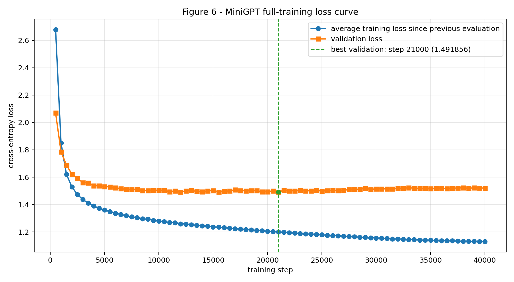

*Figure 6. Average training loss since the preceding evaluation and validation loss
through 40,000 steps. The dashed line marks the recorded best validation loss at
step 21,000.*

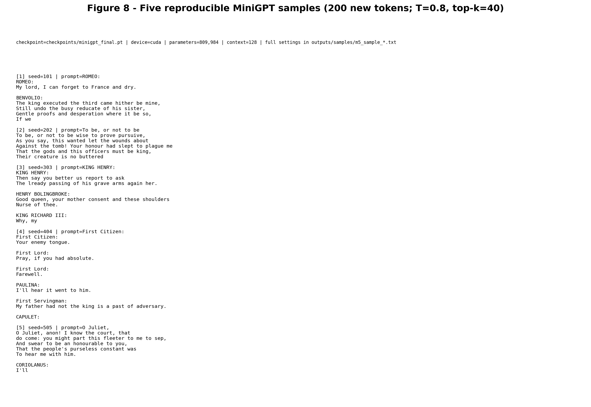

*Figure 8. Five reproducible terminal-style generation samples from the selected
best-validation checkpoint at a 200-new-character budget. Individual text evidence
preserves full metadata and real model line breaks.*

## 7. Ablation study

All primary ablations used the same Tiny Shakespeare split, seed 1337, learning rate
`1e-3`, and an 8,000-step budget. Only the named factor changed; the 4-layer,
4-head, 128-character baseline was retrained at that same budget. A second baseline
run with seed 2024 gave validation loss 1.492133 versus 1.497624 for seed 1337, a
difference of 0.005491. This is only a two-seed rough noise estimate, not a formal
uncertainty interval. CUDA timings are synchronized wall measurements, but laptop
GPU thermal state can vary, so time results are indicative rather than universal.

### Observation

Depth 2/4/6 recorded validation losses 1.592932/1.497624/1.474871, parameter counts
413,440/809,984/1,206,528, and times 81.395/141.828/201.429 seconds. Heads 2/4/8
recorded losses 1.513320/1.497624/1.489331, all with 809,984 parameters, times
123.061/143.113/223.110 seconds, and peak allocations 274.93/335.78/463.78 MiB.
Comparable fixed-prompt generations are saved for each head setting; they are
evidence, not a subjective quality score.

Contexts 64/128/256 recorded validation losses 1.550919/1.497624/1.467529, times
123.970/141.940/455.030 seconds, peak allocations 154.67/335.78/898.69 MiB, and
throughput 264,321.86/461,715.70/288,051.65 tokens/s. The full CSV and table retain
all values, including precision, validation batches, and generation-file paths.

### Interpretation

The depth-2-to-4 loss reduction (0.095308) and the context 64-to-128-to-256 loss
reductions (0.053295 then 0.030095) are much larger than the rough 0.005491 two-seed
baseline difference, so this experiment supports treating them as real effects in
this setup. The 4-to-6 depth reduction is positive but modest (0.022753) relative to
that limited noise estimate, while also adding parameters, time, and memory.

For heads, the adjacent differences are 0.015696 (2 to 4) and 0.008293 (4 to 8),
about 2.9x and 1.5x the rough noise estimate. With only two baseline seeds, this
does not establish a reliable head-count quality difference; it should not be
over-explained. The measured cost changes are clear: head count left parameter count
unchanged but increased time and peak allocation in this implementation. Longer
context improved the measured validation loss but had a substantial measured time
and memory cost at 256 characters.

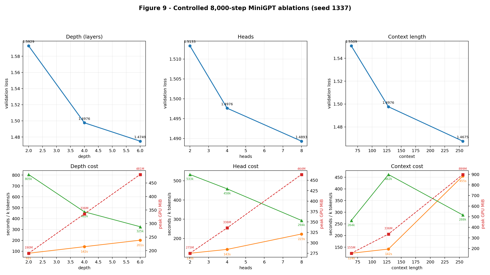

*Figure 9. Top row: validation losses for three one-factor, 8,000-step studies.
Bottom row: measured wall time, throughput, and peak CUDA allocation. The values are
also available as a labeled Markdown table and CSV.*

## 8. Failure analysis

**Lexical artifacts.** The 200-character fixed samples include unusual or malformed-
looking forms such as `pursuive` (the “To be” sample) and `lready` (the “KING HENRY”
sample); `fleeter` occurs in the incoherent fragment “you might part this fleeter to
me to sep.” The likely cause is character-level next-character prediction with a
small corpus/model: it learns local spelling fragments but has no word vocabulary or
word-level constraint. The evidence is the saved fixed-seed samples, rather than a
claim based on an imagined error.

**Grammatical-looking but incoherent continuations.** The same samples preserve
speaker labels and line breaks, yet contain statements such as “The king executed the
third came hither be mine,” and “Your honour had slept to plague me / That the gods
and this officers must be king.” These are locally Shakespeare-like but do not form a
consistent scene or proposition. A likely cause is the small 809,984-parameter model
being optimized for next-character likelihood, which rewards local patterns more
directly than multi-sentence meaning. The quoted output is actual fixed-seed evidence.

**Observed train/validation gap.** In the M5 curve, the lowest validation loss was
1.491856 at step 21,000. Training continued to final average training loss 1.129923,
while final validation loss was higher at 1.519580. This is evidence of a train/
validation gap under this schedule, and it is why inference uses the step-21,000
checkpoint. It is not proof of a single causal mechanism, but continued fitting to
the training windows after validation stopped improving is consistent with overfit.

**Limited usable history.** The model configuration and generation loop enforce a
128-character context crop. The 200-character evidence samples necessarily exceed
that history after enough generated characters, so the initial prompt cannot remain
available indefinitely. This hard architectural limit is a likely contributor to
longer-range coherence failures, although these samples alone cannot isolate its
effect from model size or training data.

**Inference-only context and repetition checks.** A fixed-seed (`111`), temperature
0.8, top-k 40 continuation generated 400 characters from the early distinctive
prompt `MONTAGUE:\nRemember MONTAGUE, my lord.\n`. The prompt contains `MONTAGUE`
twice; it occurs zero times in the 400 generated characters, including after the
first 128 generated characters where the initial prompt has rolled out of the model
window. Nothing more specific was visibly lost than that non-reappearance, so this
single generation is not a clean causal demonstration of the context limit. It is
reported as limited evidence alongside the known crop rule.

There *was* direct repetition evidence. Greedy 300-character generation from
`ROMEO:` repeated “the strength of the state” several times near its end. Temperature
0.2 sampling from `ROMEO:` repeatedly used “the sun” and “the prince”; the analogous
`KING HENRY:` continuations repeatedly used “the state,” “the prince/princess,” and
“the sea.” The exact prompts, seeds, settings, and text are saved in
`outputs/logs/m6_failure_generation_checks.txt`. These repetitions are compatible
with a small character model favoring high-probability local continuations; they are
not evidence that every decoding setting repeats in the same way.

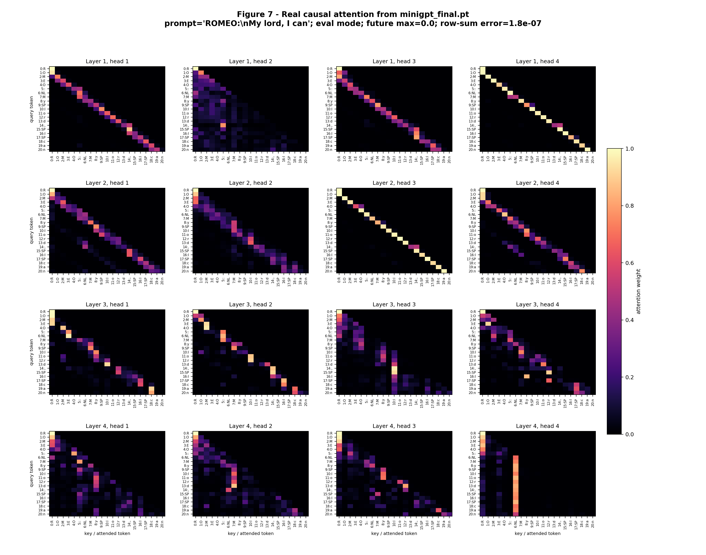

*Figure 7. Attention weights from `minigpt_final.pt` in evaluation mode for
`ROMEO:\nMy lord, I can`. The maximum weight above the causal diagonal was exactly
0.0; the largest attention-row-sum error was 1.788e-07 from floating-point rounding.
Bright near-diagonals are visible in several heads (especially layer 1 head 4 and
layer 2 head 3), while layer 4 head 4 concentrates several later queries on the
newline key. These are visible attention patterns, not claims of linguistic intent.*

## 9. Engineering packaging

The repository includes a small FastAPI service with `GET /health`, `GET
/model-info`, a validated `POST /generate`, a minimal HTML landing page, and Swagger
documentation. It loads the weights-only best-validation checkpoint on CPU once at
startup. If the checkpoint is absent, the service uses a `CHECKPOINT_URL`
environment variable rather than a committed personal URL or secret. Input limits
bound prompt length, generation length, temperature, and top-k. All responses and
the README label generated text as experimental and potentially incoherent.

Local packaging was verified with real calls run by the student: a CLI call loaded
`checkpoints/minigpt_final.pt`, and a local Uvicorn `POST /generate` call with
`{"prompt":"ROMEO:","max_new_tokens":80,"temperature":0.8,"top_k":40}` returned
HTTP 200 and generated text. The saved transcripts are rendered without alteration
in Figure 10. The Uvicorn log also recorded HTTP 200 for `/health`, `/`, and `/docs`.
The project is also deployed on Render. The live service and its interactive API
documentation are linked at the top of this document. The deployment uses
`CHECKPOINT_URL` so no credential or private download URL is committed to the
repository.

The saved CLI prompt “The future of artificial intelligence” receives Shakespeare-
style output because the model was trained only on the Tiny Shakespeare corpus; it
has no training evidence for modern factual prose or general question answering.

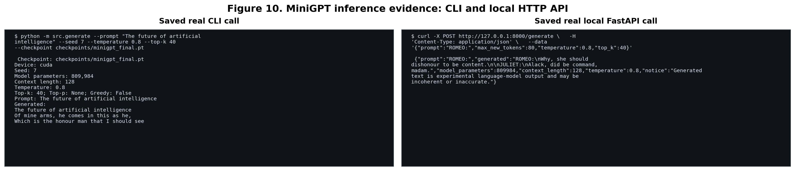

*Figure 10. Terminal-style rendering of the saved output from a real MiniGPT CLI
call and a real local FastAPI `POST /generate` call. The commands above each output
show the reported prompt and settings; source transcripts remain in `outputs/logs/`.*

## 10. Conclusion

This project produced a from-scratch, character-level causal Transformer with
manual attention and causal masking, a tested training pipeline, a compact
best-validation checkpoint, and locally verified CLI/API inference. The full run
reached best validation loss 1.491856 at step 21,000; the final step’s 1.129923
training loss and 1.519580 validation loss show a later train/validation gap, so
inference uses the earlier checkpoint rather than claiming the final one is best.

The controlled 8,000-step studies support two practical observations on this
hardware: adding depth from two to four blocks and increasing context from 64 to 128
or 256 changed validation loss by more than the rough two-seed baseline difference
of 0.005491. In contrast, the head-count loss differences were not reliable enough
to rank 2, 4, and 8 heads. The two-seed estimate is limited, and laptop timing is
temperature- and clock-state-sensitive; these results are local measurements, not
general scaling laws. The samples and failure analysis likewise support only modest
format/vocabulary imitation, not semantic coherence or factual reliability.

The checkpoint, deployed API, Colab walkthrough, and Medium article are linked at
the top of this document. These external delivery paths are kept separate from the
measured implementation evidence in this report.

## Citations and adaptations

- Assignment handout, `A1_AIE.pdf`, Sections 1–20 and curriculum Lessons 01–07:
  requirements and conceptual framing only. This submission’s code and figures were
  written for this project.
- Vaswani et al., [*Attention Is All You Need*](https://arxiv.org/abs/1706.03762):
  conceptual source for scaled dot-product attention, sinusoidal positions, and
  Transformer terminology. Equations were adapted into the report; implementation
  was written independently with permitted PyTorch primitives.
- Radford et al., [*Improving Language Understanding by Generative
  Pre-Training*](https://cdn.openai.com/research-covers/language-unsupervised/language_understanding_paper.pdf)
  and [*Language Models are Unsupervised Multitask
  Learners*](https://cdn.openai.com/better-language-models/language-models.pdf):
  conceptual references for decoder-only causal language modelling; no code or
  pretrained weights were used.
- Karpathy, [char-rnn / Tiny Shakespeare](https://github.com/karpathy/char-rnn):
  raw text download source only; no model code was adapted.
- [PyTorch documentation](https://docs.pytorch.org/docs/stable/): API reference for
  tensors, autograd, data loading, AdamW, and CUDA AMP; implementation uses only
  the permitted low-level building blocks.
- [FastAPI documentation](https://fastapi.tiangolo.com/tutorial/): routing and
  request-validation reference for the small inference service.

